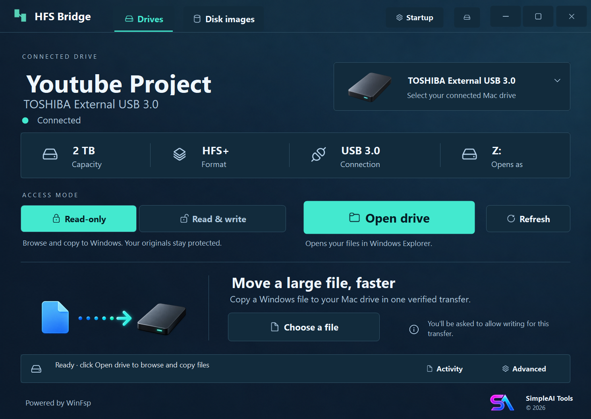

# HFS Bridge

Open Mac HFS+ and HFSX drives in Windows File Explorer, without reformatting.
By **SimpleAI Tools**. Windows x64, experimental early access.

## Download and requirements

Download the Windows ZIP from [Releases](https://github.com/simpleaibusinesstools-Simple/hfs-bridge/releases).
Extract the entire ZIP before opening `HfsBridge.Manager.exe`.

- Windows x64. Tested on Windows 11; other systems and readers need more testing.
- [.NET 10 Windows Desktop Runtime x64](https://dotnet.microsoft.com/en-us/download/dotnet/10.0).
- The signed **WinFsp 2.1.25156** driver, installed from the
  [official WinFsp release](https://github.com/winfsp/winfsp/releases/tag/v2.1).
  HFS Bridge includes its pinned user-mode DLL, not a driver installer.
- Administrator approval when opening physical drives or enabling startup.

**Early access:** filesystem writes can lose data if something fails. Back up
important files and test on disposable media first. Keep read-only mode selected
when you only need to copy files to Windows. This is not a filesystem repair tool.

## Use a Mac drive

1. Connect the drive, open HFS Bridge and select it under **Drives**.
2. Leave **Read-only** selected to browse and copy files to Windows.
3. To copy both ways, select **Read & Write**, then **Open drive** and approve UAC.
4. Copy files normally in Explorer. Keep HFS Bridge running.
5. Close the drive's files and Explorer windows, then choose **Close drive** or
   **Close drive safely** from the tray. Wait for successful close before ejecting.

For a large Windows-to-Mac file, use **Choose a file**. If the drive is open,
**Close & transfer** waits for a safe close first. Choose the file and explicitly
click **Start transfer**. Existing destination files are not silently replaced.
If open files block closing, close them and let HFS Bridge continue.

## Included features

- Read-only browsing and writable HFS+/HFSX access in Explorer.
- Verified large-file transfer alongside ordinary Explorer copying.
- Disk-image workflow that creates a new writable copy of a source image.
- System tray, explicit safe close, and opt-in account-specific startup mounting.
- Identity checks and fresh inspection before reconnecting to a remembered drive.

APFS, encryption, formatting, filesystem repair and complete Paragon feature
parity are outside this release. Automatic mounting is optional and requires
explicit setup; extracting the ZIP does not install a task or service.

## Validation and limitations

The release GUI passes **50 drive-controller and 7 image-controller checks**.
The engine has image tests, native Mac validation and personal-device copying
evidence. Those results do not certify every disk, reader or Windows version.
The latest Close & transfer UI still awaits a real-drive user retry; actual
next-sign-in and corrected-build physical reconnect acceptance remain pending.
See [release notes](docs/RELEASE-NOTES.md) for the exact scope.

## Build and contribute

See [BUILDING.md](BUILDING.md) and [CONTRIBUTING.md](CONTRIBUTING.md).
Report bugs with the version, Windows version, access mode and redacted errors.
Never upload disk images, credentials, serial numbers or personal file listings.

## License and credits

HFS Bridge's original code is **GPL-3.0-only**; see [LICENSE](LICENSE).
Upstream code retains its own notices. See [THIRD-PARTY-NOTICES.md](THIRD-PARTY-NOTICES.md)
for dependency licenses and corresponding source, and [BRANDING.md](BRANDING.md).

WinFsp - Windows File System Proxy, Copyright (C) Bill Zissimopoulos.
[WinFsp source](https://github.com/winfsp/winfsp).
